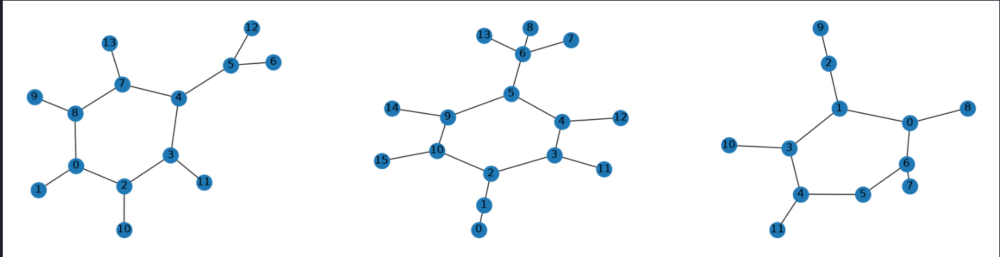
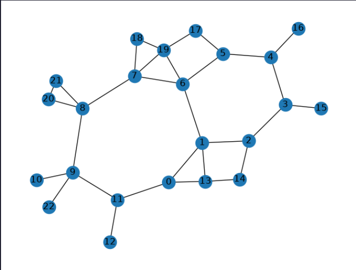

# Molecular Structure Similarity

Finding Molecules with similar structurce using Graph feature and embeddings



## Creating and Embedding Graph

There are two kinds of graph creator:
1. Normal Graph Creator
2. Proximity Graph Creator

```python
from utils.conversion import graph_creator, proximity_graph_creator

creator = proximity_graph_creator(distance=2.1)
graph = creator.createFromSmiles("N1C2C=CC=CC=2CCC(Br)C1=O")
```



Now, embeddings this graph

```python
from utils.embed import embed_graph

embeddings = embed_graph(graph, normalize=True)
```
result,
```
array([ 0.16874041,  0.20101536,  0.10900161,  0.12516901,  0.19068376,
        0.10575383,  0.18098352,  0.10912347,  0.0871754 ,  0.15084031,
        0.07036375,  0.02277507,  0.08603914,  0.        ,  0.17564933,
        0.05009212,  0.13675653,  0.19247136,  0.16054755,  0.15717095,
        0.16457125,  0.03157448,  0.11776381,  0.10330706,  0.04739708,
        0.029935  ,  0.        ,  0.05776081,  0.09507768,  0.20237374,
        0.12602615,  0.19706371,  0.13134069,  0.03406361,  0.12987999,
        0.07446273,  0.0075519 ,  0.0654498 ,  0.        ,  0.11736311,
        0.04388348, -0.00247469,  0.03073941, -0.00774846,  0.1939066 ,
        0.16551414,  0.0229781 ,  0.06103442,  0.11652026,  0.        ,
        0.1017838 ,  0.05134056,  0.0662399 ,  0.049774  ,  0.13627462,
        0.10927245,  0.11682954,  0.06749247,  0.06749247,  0.        ,
        0.14984978,  0.19237009,  0.15075903,  0.01818595,  0.12049124,
        0.07109506,  0.01752517,  0.03505034,  0.        ,  0.14235393,
        0.12936464, -0.03389663,  0.06203509,  0.0121613 ,  0.05139088,
       -0.01027818,  0.        ,  0.12140449, -0.00228541,  0.09560507,
        0.0429333 ,  0.01881458,  0.04300475,  0.        , -0.04327009,
        0.05393239,  0.09191242,  0.00277429,  0.00277429,  0.        ,
        0.14244352,  0.03643376,  0.05598572,  0.11757001,  0.        ,
        0.06625951,  0.03329701,  0.10897202,  0.        ,  0.02074679,
        0.02074679,  0.        , -0.02003913,  0.        ,  0.        ])
```

embeddings can be normalized for faster similarity computation.

---

TODOs:

1. Weisfeiler-Leman algorithm to encode node-level (atom-level) features in graph embedding
2. Add methods to convert different molecule structure formats to graphs